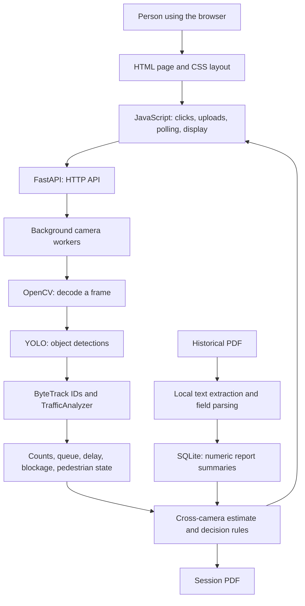

# Free-Left Traffic Dashboard: A Guide from Zero to Code

This guide explains the project as it exists in this folder. It is written for someone who understands the traffic-management idea but is learning how software turns that idea into a working program. Read it in order. Keep the project open in VS Code while using the file map near the end.

> **Safety boundary:** This project produces a local traffic-condition advisory for a person to review. It is a prototype. It is not certified for safety decisions, it does not control signal hardware, and its example camera zones must be calibrated before its measurements mean anything at a real intersection.

## 1. The project in one sentence

The browser sends three road-camera videos, or connects to locally attached USB cameras; a Python service detects and tracks traffic objects, measures activity inside hand-drawn road regions, checks the measurements against explicit safety and data-quality rules, and shows an explainable green/yellow/red advisory plus a downloadable report.

The original idea is the **product requirement**: monitor a main approach, a free-left route with pedestrians, and a joining road; avoid double-counting a vehicle across views; use queue and delay information; and show a cautious recommendation. The code is the implementation of that requirement. Knowing the idea and knowing the implementation are different skills; this guide connects them.

## 2. Learn the building blocks first

| Word | Plain meaning in this project | Example |
|---|---|---|
| Program | Instructions a computer follows | `backend/app/main.py` starts the web application |
| Frontend | The part running in your browser | HTML describes the page; JavaScript handles clicks and updates |
| Backend | The part running in Python on your computer | FastAPI receives uploads and coordinates analysis |
| API | A named request/response doorway between frontend and backend | `POST /api/v1/analysis/recorded` submits clips |
| Dependency/package | Code someone else wrote that this project uses | OpenCV reads frames; Ultralytics runs YOLO |
| Video frame | One still image from a video | At 30 frames per second, a second contains 30 images |
| Detection | One model guess about an object in one frame | “Person at box (x1,y1,x2,y2), confidence 0.83” |
| Track | A temporary ID connecting detections across adjacent frames | Track 17 is likely the same car over several frames in camera 1 |
| ROI / zone | A polygon drawn over part of a camera image | `pedestrian_conflict` marks the crossing that must remain clear |
| Metric | A number or state calculated from detections over time | vehicles in queue, stopped delay, person in the turn path |
| Decision rule | A written condition that maps metrics to a result | Person in the configured path → red advisory |
| Configuration | Values that can be adjusted without rewriting algorithms | polygons and queue thresholds in the JSON file |
| Persistence | Keeping information after a process ends | historical report summaries in SQLite |
| Callback | A function called when an event/result arrives | preview callback publishes the latest annotated frame |
| Thread | A worker that can do blocking work without stopping the web request loop | three recorded-camera workers run in parallel |
| Polling | Asking repeatedly whether the state changed | browser fetches the job status about every 33 ms |

### A tiny programming-language primer

- `name = value` assigns a value to a name. Example: `TARGET_FPS = 30`.
- `def thing(...):` defines a reusable Python function. `async def` defines an asynchronous web handler.
- Indentation defines a Python block. A line indented under `if` only runs when that condition is true.
- `if / elif / else` chooses a path; `for` repeats over a collection; `return` sends a result back to the caller.
- `class` groups related data and behavior. A `Detection` object groups a box, category, confidence, and optional track ID.
- `dict` / JavaScript object stores named values; `list` / array stores an ordered collection; a tuple is a fixed-size Python collection.
- `True` and `False` are Boolean values. `None` / `null` means “no value is available.”
- `try / except / finally` handles errors and cleanup. `finally` runs even if an earlier operation fails.
- `@router.get(...)` and `@router.post(...)` are decorators. They register the function underneath as a web route.
- `await` lets asynchronous Python wait for an operation without blocking the whole server. It does not make computer vision itself faster.
- `import` brings a module into a file. For example, `analysis.py` imports `recommend` rather than duplicating the decision logic.
- In JavaScript, `const` names a value that will not be reassigned, `let` can be reassigned, and `async / await` handles browser requests.
- `//` starts a JavaScript comment; `#` starts a Python comment; `<!-- ... -->` is an HTML comment.

## 3. The layers of the “building”

Think of the system as layers. Each one has a specific job and passes structured information to the next.



| Layer | What it does | Why the project needs it |
|---|---|---|
| User interface | Shows camera views, controls, counts, decision and report link | People need to choose inputs and understand the result |
| Browser logic | Uploads files, starts a job, polls progress, replaces preview frames and renders the signal | A browser page cannot directly call Python functions |
| Web/API layer | Validates requests, accepts files, creates job state and serves images/status | Gives the browser a reliable interface to the Python system |
| Job orchestration | Runs camera analysis outside the short HTTP request | Video analysis takes longer than a normal web request |
| Video input | Reads an uploaded clip or newest USB-camera frame | Converts the camera source into images the detector can use |
| Detection and tracking | Locates people/vehicles and associates detections over nearby frames | A count from a single frame is not a count of unique vehicles |
| Zone/metric layer | Connects object locations and motion to configured road areas | Traffic meaning depends on *where* the object is and whether it moves |
| Identity association | Tries to reconcile likely same vehicle tracklets across views | Prevents some simultaneous cross-camera recounting |
| Decision engine | Checks safety overrides, data validity and traffic pressure | Converts measurements into an explainable advisory |
| History and reports | Extracts historical PDF facts, stores summaries, creates a session PDF | Gives the current observation context and a reusable result |

## 4. Languages, frameworks and tools: what and why

| Technology | Where | Job | Why it was chosen here |
|---|---|---|---|
| Python 3.11 | Backend and vision engine | Coordinates the API, video pipeline, metrics and reports | The computer-vision ecosystem is strongest in Python |
| FastAPI | `backend/app/` | Defines HTTP endpoints and validates form/file inputs | Small, clear API layer with automatic OpenAPI documentation |
| Uvicorn | Run command | Hosts the ASGI Python application | Standard local server used by FastAPI |
| HTML | `frontend/*.html` | Defines page content and controls | No frontend build system is needed for this prototype |
| CSS | `frontend/css/style.css` | Defines sizing, spacing, colors and responsive layout | Keeps presentation separate from behavior |
| Browser JavaScript | `frontend/js/app.js` | Handles user actions and polls the API | Runs directly in the browser; no Node build step |
| OpenCV | Camera/video pipeline | Reads camera/video frames, resizes images, draws boxes and encodes preview JPEGs | Mature local image/video processing library |
| Ultralytics YOLO11n | `vision_engine/detection/yolo.py`, `yolo11n.pt` | Finds people and vehicle classes in each frame | Compact pretrained detector suitable for a prototype |
| ByteTrack | YOLO tracking option | Maintains temporary IDs across adjacent frames in one camera | Helps distinguish a continuing object from a new detection |
| NumPy | Dependency of the vision stack | Numeric arrays used by image/model libraries | The underlying numeric representation used by these libraries |
| SQLite | `data/processed/traffic_history.sqlite3` | Stores extracted historical report summaries locally | No separate database server or cloud account is needed |
| PyMuPDF | Historical PDF parser | Extracts selectable text from PDFs | Local text extraction without sending reports to a cloud service |
| ReportLab | Session report generation | Creates the downloadable analysis PDF | Generates PDFs directly from the result dictionary |
| VS Code launch config | `.vscode/launch.json` | Starts Uvicorn from the project folder | Makes the project easier to launch/debug with F5 |

`requirements.txt` is the list of direct Python packages and version ranges. A package may bring other packages with it. For example, Ultralytics depends on PyTorch; PyTorch is not listed as a separate line in this file. The project contains a bundled `.runtime` Python installation, which is different from a folder named `.venv`.

## 5. What happens when one frame is analyzed

Follow this sequence whenever someone asks “how does it know?”

1. **A source supplies an image.** In upload mode, OpenCV decodes the next selected video frame. In live mode, a background reader keeps only the newest camera frame available.
2. **The detector runs.** YOLO returns boxes, class names, confidence values and, when available, tracker IDs. The model is asked to detect COCO classes `person`, `car`, `motorcycle`, `bus`, and `truck`.
3. **A box becomes a `Detection`.** Coordinates use `(x1, y1, x2, y2)`. The `footpoint` property chooses the bottom-center of the box, a rough estimate of where a standing/wheeled object contacts the road.
4. **The analyzer maps the footpoint to zones.** Each zone is a polygon in that camera’s image coordinates. Point-in-polygon checks answer whether the footpoint is in `approach`, `free_left`, `exit`, or `pedestrian_conflict`.
5. **The analyzer updates temporal state.** For tracks it remembers last position/time, estimates image-plane speed, whether the vehicle is stopped, its accumulated stopped delay, and whether it has remained stationary long enough to count as a blockage.
6. **A snapshot is published.** Counts and metrics are copied into the camera job. An annotated image is encoded as a JPEG for the browser. A pedestrian or pedestrian/vehicle conflict can force a decision recalculation immediately; other metrics are recalculated several times each second.
7. **The decision engine checks the snapshot.** A person in a valid, fresh configured conflict/free-left area wins first and produces red. Otherwise it checks whether all camera roles exist, measurements are numeric and fresh, the zones are appropriate, and enough evidence is available.
8. **The browser paints the result.** JavaScript polls the job status, updates text beneath each camera, downloads a newer annotated frame when its sequence number advances, and updates the traffic lamp/reason.

**Important distinction:** “Vehicles in frame” is a current-frame count. “Vehicle tracks” is the number of camera-local tracked identities observed so far. These numbers answer different questions. The cross-camera unique count is a cautious estimate, not an exact plate-level identity.

## 6. The recorded-video path

1. The user picks one clip for each of the three named camera roles.
2. Clicking **Analyze three clips** immediately starts the local preview and an HTTP upload. The browser reports upload progress.
3. The FastAPI handler validates the clip types, writes uploads into a temporary input directory, creates a job ID and starts a background task.
4. The job configures CPU/GPU settings, loads the zone JSON and historical context, then starts three worker tasks using `ThreadPoolExecutor`.
5. Each worker creates a detector for its camera, reads frames, analyzes them, and calls progress, metrics and preview callbacks.
6. Partial metrics can update the advisory while the workers are still analyzing. Final results are assembled after the workers finish; cross-camera matching and the final PDF are produced at the end.
7. Temporary uploaded clips are removed in the job cleanup path. Results, JSON summary and generated PDF are retained under `data/processed/dashboard_jobs/`.

The browser-side preview/upload starts on click, but backend inference cannot analyze a video frame before that clip has arrived on the server. This build uploads all three clips together, so actual detection begins after the request has delivered them. If a very large clip is used, upload time is a real part of startup time.

## 7. The live USB-camera path

1. The user clicks **Find cameras**. OpenCV tries available Windows camera backends and returns local device indices and image sizes.
2. The user assigns a different camera device to each role and clicks **Start live analysis**.
3. Each capture source reads continuously into a one-frame/latest-frame buffer. If inference falls behind, old frames are overwritten instead of forming an ever-growing delay queue.
4. An inference worker requests up to 30 frames/s, runs YOLO/ByteTrack and the same `TrafficAnalyzer`, then publishes preview JPEGs, counters and metrics.
5. The UI polls the job and latest tracking frames. The FPS shown is measured from actual processing; 30 FPS is a target, not a promise. CPU/GPU, image size, USB bandwidth, lighting, scene complexity and detector latency all matter.

`TARGET_FPS = 30` describes a target/request cadence. It does **not** make every machine process 30 frames each second. On a CPU-only machine, the model may analyze fewer frames per second. The latest-frame buffer limits lateness, but dropping frames can also make short-lived objects harder to detect. The value called `inference_fps` measures time spent in detector calls; `processing_fps`/`end_to_end_fps` measures broader loop throughput and is the more useful measure of sustained throughput. In live mode the camera card emphasizes inference FPS, frame age and dropped frames; the underlying counts also include processing FPS.

## 8. How traffic measurements work

### Zones and geometry

The JSON file gives a reference frame size and a list of polygons for each camera. Polygons are scaled to the actual source size. `Zone.contains(point)` uses the ray-casting point-in-polygon method, with an explicit edge check. If the bottom-center point lies in a zone, that detection contributes to that zone’s interpretation.

This is image geometry. It is not real-world road geometry. A queue extent in pixels cannot truthfully be reported in meters without camera calibration (a road-plane homography) and a stop-line reference.

### Queue and delay

- On each frame, vehicle footpoints inside an `approach` zone contribute to the current approach count.
- The code estimates pixel speed by dividing displacement between observed points by elapsed seconds.
- Below `stationary_speed_px_per_second`, a vehicle is treated as stationary for the current sample; its stopped delay accumulates over observed intervals.
- The frame queue sample is moving plus stationary vehicles in the approach zone. Queue summaries include maximum and p95 values; p95 is intended to be less sensitive than a maximum to a one-frame spike.
- A blockage starts when a vehicle occupies the free-left area and has remained stationary for the configured start threshold. Its duration is updated while visible and closed when the track disappears or the clip ends.

These are camera-image estimates. Camera shake, perspective, missed/fragmented tracks, occlusion and detector errors affect them. A stationary object can be a parked vehicle; the code does not understand every real-world cause.

### Pedestrian clearance

For each frame, person detections whose footpoints fall in configured `free_left` or `pedestrian_conflict` polygons are counted. The last observed person time is remembered. The person-present safety flag remains active through the configured clearance hold (currently two seconds). A detected pedestrian/vehicle co-presence in a conflict zone has its own remembered flag. The decision engine checks those flags before waiting for three complete camera summaries. Live timestamps use elapsed capture time, so the hold is approximately two real seconds. Uploaded clips use video timestamps, so the same hold is two seconds of clip time; if the backend processes faster than playback, that is not necessarily two wall-clock seconds.

If a person is visible but their footpoint lies outside the polygon, the rule does not know that the person is in the free-left route. The zone must fit the real route and crossing. Detection is a model estimate, so a missed person is possible.

### Joining road

The exit camera’s `exit`-kind region represents the right-side joining road. The analyzer samples vehicles seen there, counts movement/stationary/unclassified observations, and tracks the maximum stopped vehicle count and longest stationary duration. The decision rules treat a sustained stopped joining flow as a reason for yellow; a large or long-lasting queue can force red. A new or not-yet-tracked vehicle is initially “unclassified”; the system should not call that evidence clear.

## 9. Cross-camera de-duplication: what it can and cannot do

Each camera has its own tracking IDs. ID 12 in camera 1 does not mean the same physical car as ID 12 in camera 2. The matching code therefore builds short-lived appearance descriptors from HSV color histograms of vehicle boxes, compares track categories and timestamps, then only merges candidates with strong similarity and no close competing lookalike. Offline matching also assumes clips share a clock; configurable offsets can correct known clock differences. Live matching waits for repeat evidence and an ambiguity interval.

Why this conservative design? A car can look different from another camera because of lighting, angle, shadows, occlusion and distance. A color match alone is weak evidence. When candidates are ambiguous, the algorithm abstains instead of merging them and gives an upper bound (the sum of local tracklets) alongside the estimate.

**Privacy tradeoff:** This implementation does not perform license-plate recognition. Color histograms/descriptors are temporary in-memory data for matching; the code does not save vehicle crops as identity records. That reduces privacy exposure, but it also means this cannot deliver guaranteed vehicle identity. This is pseudonymous short-term appearance matching, not proof that two views show the same car.

## 10. How the traffic-light advisory is calculated

The order of operations matters.

### Gate A: immediate safety override

If a fresh/valid camera summary reports a person in the configured free-left/pedestrian-conflict path, or a recent pedestrian/vehicle overlap, return red immediately. This is evaluated before the “all three camera summaries” gate. It prevents other cameras’ startup delays from hiding a known conflict.

### Gate B: validate evidence

For a normal traffic-pressure decision, require exactly the roles `approach`, `turning`, and `exit`, no duplicate/unknown roles, required fields with finite non-negative values, valid expected zone kinds, and live measurements no more than 2.5 seconds old. Green also needs at least two seconds and 30 processed frames per view. Missing/invalid evidence produces yellow/insufficient-data, not green.

### Gate C: calculate explainable pressure points

The present code uses these capped components:

```text
queue points    = min(40, p95_queue / queue_high_threshold * 40)
delay points    = min(25, max_average_stopped_delay / delay_high_threshold * 25)
blockage points = min(20, longest_blockage / blockage_high_threshold * 20)
conflict points = 25 if person/conflict flag is active, otherwise 0
current score   = min(100, sum of the four components)
```

`max_average_stopped_delay` means the maximum per-camera stopped delay divided by that camera’s vehicle-track count (at least one to avoid division by zero). Queue uses the worst view’s p95 queue rather than adding the same road’s vehicles across multiple views.

The total score makes the decision easier to explain, but explicit rules also matter: any high queue, blockage, delay or score can trigger high severity; medium thresholds trigger medium severity. The joining-road queue has separate stopped-vehicle/time conditions. Conflicts trigger red regardless of score.

### Gate D: translate severity and confidence to color

- High pressure/conflict → red.
- Medium pressure, historical watch or incomplete confidence → yellow.
- Green is possible only when pressure stays below medium thresholds **and** all required views have enough current evidence.

The returned object contains the reason, rule name, severity, light label, confidence, input metrics, data-quality warnings and historical context. This makes the result inspectable rather than a mysterious model output.

### Why the past PDF cannot overrule the cameras

The PDF parser extracts labeled, supported facts locally. SQLite stores the extracted numeric summary and metadata, not the original uploaded PDF or its full text. History must match the selected site and be recent (within a year) and confidently parsed to affect the current advisory. Its capped contribution can add a watch/yellow factor near a threshold; history alone cannot cause red. Current observations take precedence.

### One current code inconsistency to know

`DecisionThresholds` and the JSON expose `joining_flow_stationary_ratio_medium`, but the `joining_flow_alert` calculation at `backend/app/decision_engine/rules.py:250` currently compares against a literal `0.65`. Changing the JSON value therefore does not change that particular alert. That is a small but real configuration bug to correct before relying on per-site threshold tuning. It does not change the basic explanation of the current rule.

## 11. Privacy and saved data

| Data | Where/how long | Why |
|---|---|---|
| Uploaded video source | Temporary job input directory; deleted in `_run_job` cleanup | Needed to decode/analyze the clip |
| Live camera frames | In-memory latest-frame buffer and transient preview JPEG | Needed for inference and browser preview; not saved as a recording |
| Vehicle appearance features | In-memory while the job is running | Needed for conservative cross-camera association |
| Per-camera measurements | Job state during analysis; summary JSON afterwards | Needed to render/review the result |
| Session PDF and summary JSON | `data/processed/dashboard_jobs/<job-id>/` | User-accessible result/report |
| Imported historical source PDF/full text | Parsed in memory and discarded | The parser retains only supported facts |
| Historical report summaries | `data/processed/traffic_history.sqlite3` | Compare recent reports for the same site |
| Logs/errors | Local process logs | Debugging and failures |

“Local” means the application code sends these inputs to the local Python service on this computer; the documented flow does not use a cloud vision API. The output report can still contain traffic numbers, and users should protect the machine and output folder appropriately. Privacy does not mean that every derived number is anonymous.

## 12. Start it in VS Code on this machine

The current folder already contains a bundled Python runtime at `.runtime\python311\python.exe`. That is why commands using `.venv\Scripts\python.exe` or `py` can fail: those names refer to different installations that may not exist. From the project folder in the VS Code PowerShell terminal:

```powershell
$env:PYTHONPATH = "$PWD\backend;$PWD"
.\.runtime\python311\python.exe -m uvicorn app.main:app --app-dir backend --host 127.0.0.1 --port 8765 --reload
```

Then open `http://127.0.0.1:8765/dashboard.html`. The terminal must stay open while the server is running. Press **Ctrl+C** to stop it. The same server launch is configured in `.vscode/launch.json` (Run and Debug → “Run traffic dashboard”; F5).

If `.runtime\python311\python.exe` is absent in a fresh copy, install Python 3.11, create a virtual environment, install `requirements.txt`, and substitute that environment’s Python executable in the same Uvicorn command. Do not paste the command prompt characters (`>` or `>>`) into PowerShell.

## 13. Project file map, with reading order and line ranges

Counts below are for the current project-owned tree, including this guide and excluding `.runtime`, Python package internals, the model weights and generated `data/` outputs: **24 files** including `.gitignore`; **23 readable source/document/config files with 4,500 lines**. Counts are a snapshot and change when code is edited. There is no maintained JavaScript package/build tree. `backend/tests` currently contains cache artifacts but no checked-in `.py` test modules.

Read the starred files first. Line ranges are approximate signposts; use VS Code Go to Line (`Ctrl+G`) because adding comments changes later line numbers.

| Order | File (current lines) | What to learn there |
|---:|---|---|
| 1 | `README.md` (68) | Product scope, setup, three roles, FPS, rules, privacy and limits |
| 2 | `requirements.txt` (8) | Direct Python packages and allowed versions |
| 3 | `.vscode/launch.json` (16), `.vscode/settings.json` (12) | F5 launch, project working directory and editor behavior |
| 4 | `frontend/index.html` (20) | Welcome page and link to dashboard |
| 5 | `frontend/dashboard.html` (93) | Camera cards, upload/live controls, counts and signal lamp IDs |
| 6 | `frontend/css/style.css` (66) | Page layout and visual states |
| 7 | `frontend/js/app.js` (559) | Browser state, upload, API calls, polling, counters, live decision display |
| 8 | `backend/app/main.py` (44) | FastAPI app, route registration, cache behavior, static files |
| 9 | `backend/app/api/routes/health.py` (12) | Simple liveness route |
| 10 | `backend/app/api/routes/analysis.py` (760) | Upload/live endpoints, job state, camera workers, status/frame endpoints, report creation and decision timing |
| 11 | `vision_engine/detection/yolo.py` (92) | Detection object and YOLO/ByteTrack adapter |
| 12 | `vision_engine/roi/zones.py` (49) | Polygon representation, point-in-polygon and config conversion |
| 13 | `vision_engine/metrics/traffic.py` (371) | Track state, per-frame zone tests, queue/delay/blockage/pedestrian measurements |
| 14 | `vision_engine/camera/video_analysis.py` (311) | Recorded clip frame loop and callbacks |
| 15 | `vision_engine/camera/live_capture.py` (281) | USB discovery, latest-frame source and real-time worker |
| 16 | `vision_engine/metrics/cross_camera.py` (222) | Offline and live conservative appearance/time matching |
| 17 | `backend/app/decision_engine/rules.py` (429) | Data validation, safety override, scoring and color recommendation |
| 18 | `backend/app/reporting/historical_reports.py` (329) | PDF size/page limits, extraction, field parsing and SQLite storage |
| 19 | `backend/app/api/routes/history.py` (44) | PDF import and site-history API routes |
| 20 | `backend/app/reporting/session_pdf.py` (258) | User-downloadable session report layout and signal/vehicle/pedestrian timeline tables |
| 21 | `config/camera_zones.example.json` (38) | Camera polygons, timestamp offsets and configurable thresholds |
| 22 | `.gitignore` | Files that should not be committed (runtime/cache/output files) |

### Important function-by-function map

#### Browser: `frontend/js/app.js`

- Lines 1–18: IIFE wrapper (keeps variables private), camera-role-to-DOM mapping and mutable job/UI state.
- 20–49: count selected clips, set button labels and lock inputs during an analysis.
- 51–97: notification, HTML escaping, bounded API requests, health status and site label.
- 99–140: render locally stored historical report summaries and load history for a site.
- 142–182: validate and upload a PDF, show parsing/storage result, always unlock controls.
- 184–227: create/revoke browser-local video URLs and show chosen clip previews.
- 230–240: clear the tracking images and reset observation text for a new job.
- 242–264: XHR multipart upload with percentage progress (XHR is used because it exposes upload progress).
- 266–317: copy current counts/status to the page and fetch changed annotated frame sequences.
- 319–331: convert decision JSON to the colored lamp, label, reason and evidence text.
- 333–342: render the completed result and report/history links.
- 344–412: recorded-video click flow, upload, job polling, frame/counter/signal updates, stop/failure cleanup.
- 414–440: ask the backend to discover local USB devices and fill the camera selectors.
- 442–508: live mode startup, status polling, updating previews and UI cleanup.
- 510–533: switch upload/live controls and wire HTML events to JavaScript functions.
- 535–559: register controls and periodic API-health display.

#### Backend orchestration: `backend/app/api/routes/analysis.py`

- Lines 1–42: imports, project/config/output paths, camera role tuple, global in-memory job registry and router.
- 43–50: site-history wrapper; 51–110: `_publish_job_decision` records update intervals and advisory color transitions.
- 111–127: JSON-to-`DecisionThresholds` conversion; 129–167: reject malformed config, bad polygons and invalid thresholds.
- 169–234: recorded upload validation, 1 MiB chunk writes, create job and schedule background worker.
- 236–256: report runtime availability; 258–267: USB camera listing.
- 269–335: validate and launch a local USB live job.
- 337–350: stop endpoint sets an event; worker stops after its current inference frame.
- 353–370: job status and newest preview JPEG endpoints; 373–381: persistent session PDF download endpoint.
- 383–507: one-camera recorded worker: scale zones, create detector, feed callbacks, call `analyze_video`.
- 509–598: recorded coordinator: initialize libraries/device, run three camera workers concurrently, combine summaries, match tracklets, make final decision and save outputs.
- 600–760: live coordinator: initialize runtime, create per-device workers, update shared metrics/identity/decision, handle partial/errors/stops and produce final result.

#### Core measurement and inference files

- `vision_engine/detection/yolo.py`, lines 8–19: immutable `Detection` data and the bottom-center `footpoint`; 22–29: structural interfaces for replaceable detectors/models; 31: class IDs; 34–92: load model and normalize YOLO results into project-owned `Detection` values.
- `vision_engine/roi/zones.py`, lines 10–38: validate polygons and use ray casting for inside/boundary checks; 42–49: parse JSON-like dictionaries into typed zones.
- `vision_engine/metrics/traffic.py`, lines 13–26: vehicle state remembered between frames; 29–124: serializable metrics and derived summaries; 126–162: analyzer setup; 163–334: per-frame state update and queue, speed, stopped delay, blockage, pedestrian and joining-road state; 335–361: close open events and choose blockage severity; 362–371: classify image-plane movement direction. The optional `pedestrian_nearby` zone expands the vehicle side of a crossing conflict; a person outside the configured route does not by itself trigger the conflict rule.
- `vision_engine/camera/video_analysis.py`, lines 16–259: validate/open clip, read frames, optionally skip frames, detect/track, compute features, update the traffic analyzer, publish metrics/previews and finish summaries; 263–310: draw ROI/box/status overlays.
- `vision_engine/camera/live_capture.py`, lines 17–77: continuously read latest frame without a backlog; 79–100: enumerate local webcam devices; 103–277: live detector/tracker loop, metrics, status, frame age/FPS and cleanup; 278 onward: crop helper used for appearance features.
- `vision_engine/metrics/cross_camera.py`, lines 15–20: cosine similarity; 23–104: offline time/category/color matching and ambiguity abstention; 107 onward: live matching state, short-lived candidate confirmation and identity summary.

#### Decision, history and report files

- `backend/app/decision_engine/rules.py`, lines 15–28: roles, required zones/fields; 30–59: configurable thresholds and validation; 61–79: zone/numeric validators; 81–100: safe “insufficient” response; 102–157: recommendation entry and immediate pedestrian override; 158–240: camera role/field/freshness validation and joining-flow evidence; 241–330: pressure metrics and rule evaluation; 331–429: historical watch, confidence, lamp output and explainable metrics.
- `backend/app/reporting/historical_reports.py`, lines 15–69: DB path, limits, schema and safe connection lifecycle; 71–108: normalize site and extract bounded PDF text; 110–220: parse supported labels, units and dates with confidence/warnings; 222–262: validate/insert one unique report; 264–329: combine reports into a site-context summary.
- `backend/app/api/routes/history.py`, lines 12–36: PDF upload validation, byte limit, local parsing/storage and cleanup; 39–44: read site history.
- `backend/app/reporting/session_pdf.py`, lines 8–236: build a PDF from session metrics, decision timeline and region counts; 237–258: formatting and PDF-safe text helpers.
- `backend/app/main.py`, lines 13–24: app/static paths and router mounting; 27–34: no-store cache headers for working UI assets; 37–44: serve welcome page and static frontend.
- `backend/app/api/routes/health.py`, lines 8–12: report that the Python process responds; it does not guarantee cameras or models are ready.

## 14. How to answer common “why?” questions

**Why three camera roles?** Each role observes a different part of the traffic conflict: approach queue, free-left/pedestrian path, and joining-road flow. Mixing their data without role labels would make each measurement ambiguous.

**Why YOLO?** The model needs to recognize common road objects quickly. YOLO supplies detections; it does not itself decide whether a queue is safe or a signal should be green.

**Why add ByteTrack?** A detector sees each frame separately. Tracking helps connect the car in frame 20 to the car in frame 21, so motion and track totals can be estimated. A tracker ID is local to one camera/session, not a permanent vehicle identity.

**Why zones instead of interpreting the entire image?** “Person anywhere in the image” may include a sidewalk that does not conflict with the turn. A zone expresses which image region matters. It must be correctly calibrated.

**Why a red hard-stop override?** A detected person in the configured path is a direct safety conflict, so queue confidence should not delay a red advisory.

**Why does the app show yellow when it is unsure?** A false green is more dangerous than an honest “not enough evidence” state. The program withholds green when a view is missing, stale, uncalibrated, or too new.

**Why not use number plates to deduplicate?** Plate recognition collects sensitive identifiers and is fragile under blur/angle/lighting. This prototype uses temporary appearance/time clues and leaves uncertainty visible. The cost is that the estimate is not exact.

**Why use a database for PDFs?** The dashboard needs historical summaries after a report import and after a server restart. SQLite stores those small facts locally without requiring a database server. It is not used to store the videos.

**Why not let history determine the light?** A past jam is context, not proof of current conditions. Recent history can add a bounded caution factor, but live/current camera evidence must lead.

**Why can’t we promise 30 FPS?** A requested rate is not the rate the computer achieves. Each frame needs capture, model inference, tracking, metrics, encoding and display. The actual bottleneck depends on hardware and resolution; the UI reports measured rate.

**Why are there many files?** Each layer has a single responsibility: page vs. page behavior, camera reading vs. measurement, raw observation vs. decision rules, and report parsing vs. PDF output. This separation makes changes easier to test and explain.

## 15. Limits and unfinished engineering work to be honest about

1. **Site calibration is required.** The example polygons are generic. Until redrawn on each real camera view, people and vehicles may be in the wrong logical region.
2. **Vehicle identity is estimated.** Color/time matching can miss a true match or falsely merge lookalikes. It must not be presented as a guaranteed unique count.
3. **FPS is device-dependent.** “30 target FPS” is not measured proof of 30 processed FPS. Small image size and frame dropping trade detail for speed.
4. **Pixel geometry is not meters.** Physical queue length/speed require calibration and known road-plane geometry.
5. **PDF extraction is label/rule-based.** Scanned image PDFs need OCR, which is not enabled. Unusual formats may produce warnings or be rejected.
6. **Rule thresholds need field validation.** Current defaults are engineering starting points, not transportation-agency standards. Thresholds must be checked on labeled, site-specific footage.
7. **A detected object is not certainty.** Blur, night, occlusion, camera shake, unusual vehicles and model limits can create false negatives/positives.
8. **No automated control exists.** The application does not send a signal phase command or calculate certified phase duration.
9. **One configuration threshold is currently hard-coded.** The joining-flow stationary ratio inconsistency documented in section 10 should be fixed before tuning that specific value.
10. **Automated test coverage is incomplete.** There are no checked-in Python test modules in the current tree, even though test cache files exist. Unit/integration tests should be added before expanding or relying on the logic.

## 16. A study plan that reaches line-by-line understanding

Use one short study session per layer rather than trying to memorize thousands of lines at once:

1. Learn the primer in section 2, then explain the architecture diagram without looking.
2. Read `dashboard.html`; list every button, input, camera card and output label.
3. Read `app.js` beside the page; for every event handler, name its input, API call, state change and displayed output.
4. Read `main.py` and the route signatures in `analysis.py`; trace one HTTP request by its URL and method.
5. Read `Detection`, then `Zone`, then `TrafficAnalyzer`. For a sample box, compute the footpoint and decide which polygon contains it.
6. Read `analyze_video()` and `run_live_camera()` side-by-side. Point out what the two source modes share and what differs.
7. Read `recommend()` only after you understand its metrics. Explain the urgent override, validation gates, score components, threshold rules, confidence gate and historical cap in that order.
8. Finish with `cross_camera.py`, then the PDF/SQLite code. Explain both privacy protections and what remains uncertain.

For a literal line-by-line session, start with `Detection` in `vision_engine/detection/yolo.py` lines 8–19; it is small enough to understand every token. Then move to `Zone` lines 10–38. Continue in the study-plan order. At each line ask: **what value enters here, what changes, who calls this, what gets returned, and what visible result depends on it?** That method scales to the entire 3,949-line source/document/config snapshot.

## 17. A short presentation answer

> “My project is a local three-view traffic advisory prototype. The first camera measures the approach, the second monitors the free-left and pedestrian-conflict area, and the third watches the joining road. The browser sends recorded clips or the Python service reads wired USB cameras. YOLO detects people and vehicles; ByteTrack connects detections over nearby frames. A zone-based analyzer estimates counts, motion, queues, stopped delay and conflicts. A separate decision engine checks data freshness and calibration, gives a person in the configured turn path an immediate red override, then evaluates queue/delay/blockage and joining-road pressure. Recent PDF reports can add only a capped caution factor; they cannot independently produce red. The interface explains its evidence and shows measured FPS. Camera frames and PDFs are processed locally, but the project is still a prototype: zones and thresholds need site validation, cross-camera identity is only an estimate, and the advisory does not control real signals.”

If someone asks “what is the biggest risk?”, answer: **incorrect or incomplete camera evidence**—especially uncalibrated zones or missed detections. The rules can only make a sensible decision from measurements they receive.
